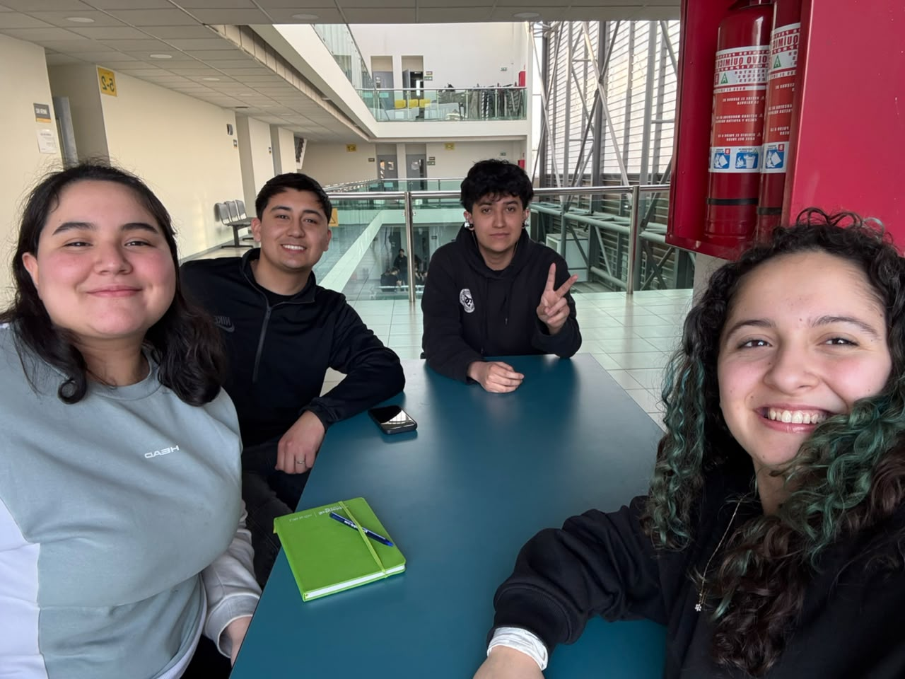

# Sistema de Registro y Caracterización de Usuarios

## Capstone Intermedio 2026

**Equipo:** Capstonersitos
**Desafío:** 01 | Edificios Inteligentes (Caracterización de usuarios del Hub Providencia)
**Contraparte:** Municipalidad de Providencia / Hub Providencia
**Estado actual:** En desarrollo

## Descripción
El Hub Providencia recibe diariamente a emprendedores, startups, estudiantes y visitantes, pero actualmente hay información limitada sobre quiénes utilizan el edificio y cómo se comportan. Nuestro proyecto consiste en diseñar e implementar una solución de registro e identificación de usuarios, acompañada de un dashboard de visualización, para apoyar la gestión y la toma de decisiones sin depender de software con licencias pagadas.

## Equipo
| Integrante | Carrera o especialidad | Rol inicial | Aporte esperado |
|---|---|---|---|
| Marcos Quilapan| Ingeniería Civil Industrial | Líder del proyecto |  Coordinar al equipo, organizar las actividades, distribuir tareas, realizar seguimiento de los avances y facilitar la comunicación entre los integrantes. |
| Thiare Muñoz| Ingeniería Civil Industrial | Diseñador UX/UI y Experiencia de usuario | Identificar necesidades de los usuarios, diseñar la interfaz y experiencia de usuario, y participar en la evaluación y mejora del prototipo. |
| Byron Gonzalez| Ingeniería Computación e Informática | Encargado de datos y Analytics | Organizar y analizar los datos obtenidos, identificar patrones de uso y desarrollar indicadores y visualizaciones que apoyen la toma de decisiones. |
| Catalina Romero| Ingeniería Computación e Informática | Desarrollador / Responsable técnico | Desarrollar el prototipo, implementar las funcionalidades necesarias y apoyar técnicamente al equipo durante el proyecto.|

## Valores del equipo.

Durante nuestra primera reunión acordamos que los principales valores que guiarán nuestro trabajo serán:

- Valor 1 : Respeto.
- Valor 2 : Responsabilidad.
- Valor 3 : Puntualidad.
- Valor 4 : Comunicación.
- Valor 5 : Colaboración.
- Valor 6 : Compromiso.
- Valor 7 : Creatividad.
- Valor 8 : Proactividad.
- Valor 9 : Escucha Activa.
  
Estos valores permitirán mantener una dinámica de trabajo donde todos tengamos la oportunidad de participar, aportar ideas y asumir responsabilidades.

## Normas.
1. **Puntualidad y Asistencia:** Si se organiza una reunión como grupo, los integrantes deben cumplir con la asistencia y la puntualidad para trabajar. En caso de no poder se tiene que avisar horas antes.
2. **Reparto Equitativo de Tareas:** Las tareas se deben distribuir equitativamente, asegurándose que cada integrante asuma la responsabilidad de lo que se le asigne.
3. **Cumplimiento de plazos:** : Si se requiere de una fecha límite de entrega, los integrantes deben estar al pendiente de tener todo correcto en lo que se le pide, logrando una revisión en conjunto antes de la entrega final.
4. **Respeto:** : Todos tienen el derecho de opinar y que las opiniones sean escuchadas, manteniendo el respeto y priorizando la crítica constructiva para el equipo.
5. **Forma de resolver conflictos:** En caso de existir un conflicto por desacuerdo o problemas personales, el equipo debe buscar una manera en que se solucione ese problema.
6. **Calidad y revisión previa:** Todo avance debe ser revisado por el equipo antes de ser enviado, asegurando la calidad del trabajo final.

## Desafío inicial
Diseñar un prototipo funcional para registrar ingresos y analizar los perfiles de uso del Hub Providencia.
* **Lo que sabemos:** Falta información sobre los visitantes y se requiere un sistema que evite a los usuarios tener que completar sus datos en cada visita.
* **Lo que no sabemos:** Tecnologías óptimas sin costo para el contexto específico del Hub.
* **Supuestos a comprobar:** Los usuarios estarán dispuestos a realizar un enrolamiento inicial rápido si se les explica el beneficio.

## Objetivo SMART del equipo
Diseñar un prototipo funcional de registro de ingresos y un dashboard para el Hub Providencia, utilizando software sin costo, para presentarlo validado con datos reales al final del semestre.

## Compromisos individuales SMART.
| Integrante | Compromiso | Smart | Plazo |
|---|---|---|---|
| Marcos Quilapan| COORDINACIÓN Y SEGUIMIENTO | Me comprometo a coordinar y realizar seguimiento del trabajo del equipo, registrando los acuerdos, responsables y fechas de cada reunión, y verificando semanalmente el avance de las tareas para alcanzar al menos un 90% de cumplimiento de los compromisos establecidos durante las primeras cuatro semanas. |  Primeras 4 semanas. |
| Catalina Romero| INVESTIGACIÓN Y USUARIOS | Me comprometo a investigar las necesidades y características de los usuarios del Hub Providencia, recopilando información que permita identificar al menos 5 necesidades, dificultades o patrones de comportamiento relevantes durante las primeras cuatro semanas, para utilizarla como base en el desarrollo de la solución. |  Primeras 4 semanas. |
| Thiare Muñoz| DISEÑO Y EXPERIENCIA DE USUARIO | Me comprometo a diseñar una propuesta inicial de la experiencia de usuario y del funcionamiento de la solución, desarrollando al menos un prototipo inicial durante las primeras cuatro semanas, considerando la información obtenida de los usuarios y las necesidades identificadas por el equipo. | Primeras 4 semanas. |
| Byron Gonzalez| DATOS Y ANÁLISIS | Me comprometo a definir y organizar las variables necesarias para caracterizar a los usuarios del Hub Providencia, estableciendo al menos 5 indicadores de uso que permitan analizar perfiles, frecuencia de visitas, espacios utilizados y patrones de uso durante las primeras cuatro semanas. | Primeras 4 semanas. |

## Usuarios y contexto
El problema lo vive el equipo de gestión del Hub Providencia (al no tener datos estructurados para planificar) y los mismos usuarios del edificio (que enfrentan un proceso poco optimizado). Todo esto ocurre en las dependencias físicas del Hub Providencia.

## Índice de la bitácora
- [S01 - Presentación del Curso e Introducción a Proyectos Capstone](bitacora/S01.md)
- [S02 - Identidad del equipo y desafío](bitacora/S02.md)
- [S03 - Comprensión del Desafío y Mapas](bitacora/S03.md)
- [S04 - Semana de Trofeo Mayor y Actualización de Bitácora](bitacora/S04.md)
- [S05 - Evaluación 1 y Entregable](bitacora/S05.md)
- [S06 - Semana de receso](bitacora/S06.md)
- [S07 - Salida a Terreno: Visita al Hub Providencia](bitacora/S07.md) 
- [S08 - Contingencia y Ajuste de Cronograma](bitacora/S08.md)
- [S09 - Sesión de Trabajo Autónomo: Síntesis e Integración del Diagnóstico](bitacora/S09.md)

## Evidencias principales
- [Por agregar a medida que avance el proyecto]

## Decisiones relevantes
| Fecha | Decisión | Evidencia o criterio utilizado |
|---|---|---|
| 20-08-2026 | Conformación de equipo y roles | Reunión inicial de Capstone |

## Próximo hito
Realizar el levantamiento del flujo actual de ingreso de los espacios en el Hub y comenzar a explorar opciones de registro sin costo de licencia.

## Uso y licencia
Por definir con el equipo docente y la contraparte. No reutilizar ni publicar información reservada sin autorización.
