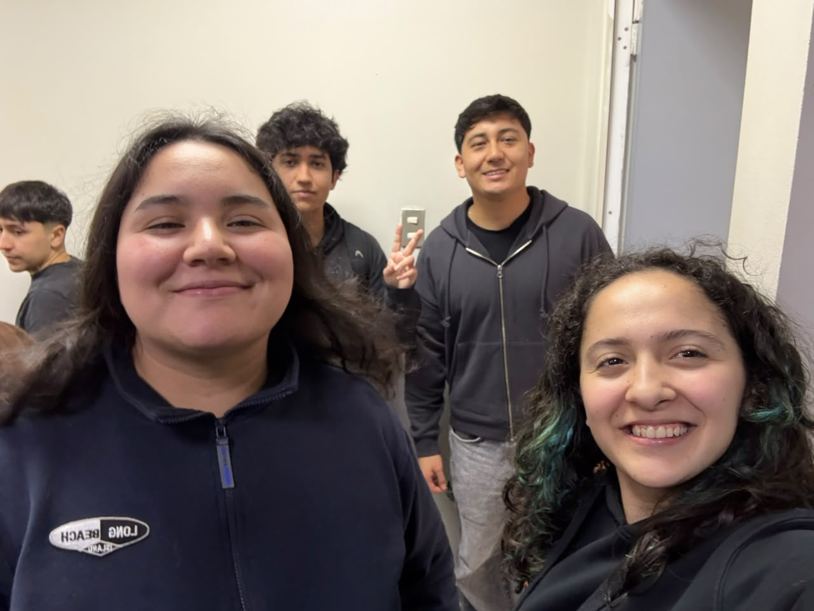

# S11 - Revisión de Propuesta, Viabilidad Operativa y Preparación Entrega 2

**Fecha:** 22 Octubre 2026
**Participantes:** Marcos, Thiare, Byron, Catalina

## Objetivo de la sesión
Revisar junto al equipo docente el estado de avance del proyecto de cara a la Entrega 2 (20%), aterrizar la factibilidad operativa e implementación del piloto en el Hub Providencia y presentar los avances en la plenaria del curso.

---

## 1. Retroalimentación y Estado del Equipo

Durante la primera parte de la sesión se realizó un balance sobre el progreso del equipo *Capstonersitos* respecto al calendario del semestre (transición de la Unidad 2 a la Unidad 3: Análisis de Soluciones y Prototipado):
* **Avances consolidados:** Tras la visita al Hub Providencia y la evaluación de tres alternativas conceptuales, el equipo definió como solución definitiva el **Sistema de Check-in vía QR de Cédula de Identidad con Base de Datos Seudonimizada**.
* **Organización:** Se distribuyeron los roles para el desarrollo del prototipo funcional (interfaz de captura, estructuración de la base de datos con *hashing* para protección de datos y diseño del dashboard) y la preparación del Pitch de avance.

---

## 2. Bajada Operativa: Integración al Contexto Real del Hub Providencia

Atendiendo a los criterios de ingeniería exigidos en la sesión ("propuesta que funcione en un contexto real"), definimos los parámetros de implementación, costos y operación para la contraparte municipal:

### A. ¿Quién utilizará y quién administrará el sistema?
* **Usuarios finales (Visitantes):** Interactúan únicamente en el punto de acceso (enrolamiento inicial por única vez en formulario web y, en visitas posteriores, escaneo de 3 segundos del QR de su carnet más selección de espacio).
* **Administrador del sistema (Equipo Gestor del Hub):** El personal de recepción supervisa el punto de ingreso, mientras que la administración del Hub consulta el Dashboard automatizado para visualizar métricas de ocupación, perfiles y horarios punta.

### B. Recursos Necesarios y Costos (Implementación y Mantenimiento)
* **Licencias de Software ($0 CLP):** Cumpliendo la restricción del cliente, tanto el formulario de enrolamiento, la base de datos estructurada y el motor de visualización utilizan herramientas gratuitas / open-source.
* **Hardware requerido:** Se aprovecha el computador/tablet actual de la recepción del Hub. Opcionalmente, se considera un lector óptico USB de códigos QR estándar (costo único aproximado entre $15.000 y $25.000 CLP) o el uso sin costo de la cámara web del dispositivo existente.
* **Costo de Mantenimiento ($0 CLP):** Al no depender de servidores pagados ni suscripciones mensuales, la mantención es autónoma y sin costo operativo para la Municipalidad.

### C. Capacitación y Resolución de Casos Borde
* **Capacitación:** Requiere una inducción breve (15 a 30 minutos) para el personal de recepción sobre cómo abrir la interfaz de lectura y cómo guiar a un usuario nuevo hacia el código QR de enrolamiento inicial.
* **Casos borde (Contingencia):** Si un visitante extranjero o nacional no porta su cédula física, la interfaz permite digitar manualmente su RUT/Pasaporte para no bloquear su ingreso al edificio.

### D. Plan Piloto y Comprobación de Éxito
* **Implementación del Piloto:** Prueba en recepción durante una jornada en horario punta con usuarios reales del Hub.
* **Indicadores de validación:**
  1. Disminución del tiempo de registro de usuarios recurrentes (meta: < 5 segundos por persona).
  2. Tasa de captura exitosa del espacio de destino (*Cowork, Sala de Reuniones, Taller*).
  3. Generación automática de gráficos en el Dashboard sin intervención manual en las planillas.
### Actividad
* **Ademas de esto se realizo la actividad asignada por la profesora, la cual fue subida al portal en la fecha correspondiente de manera individual de todos los integrantes del grupo. 
---
---

## 4. Registro Fotográfico

*Figura 1: Trabajo del equipo y revisión de avances durante la Sesión 11.*
